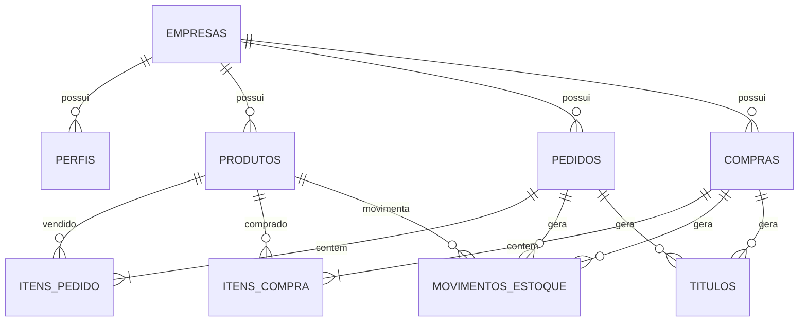

# Modelo de dados

Cada registro pertence a uma empresa. As chaves estrangeiras compostas impedem relacionamentos entre empresas. `perfis` associa um usuário autenticado a um papel por empresa. A criação inicial de empresas e administradores requer operação administrativa confiável; o usuário comum não cria seu próprio vínculo.

O saldo é a soma dos movimentos; o alerta compara o saldo com o estoque mínimo. Receber compra gera entrada e título a pagar. Faturar bloqueia produtos, confere saldo e gera saída e título a receber na mesma transação. Cancelar gera estorno e cancela o título; se houver baixa, o cancelamento é recusado. A baixa registra data e muda o estado uma única vez. Itens são imutáveis após inserção nesta etapa.

RLS limita linhas pela empresa e pelo papel. Administrador gerencia perfis; vendas acessa pedidos; estoque acessa compras e produtos; financeiro acessa títulos. Operações de estoque e financeiro ocorrem apenas pelas funções, que verificam o papel novamente. A visão usa os direitos de quem consulta.
